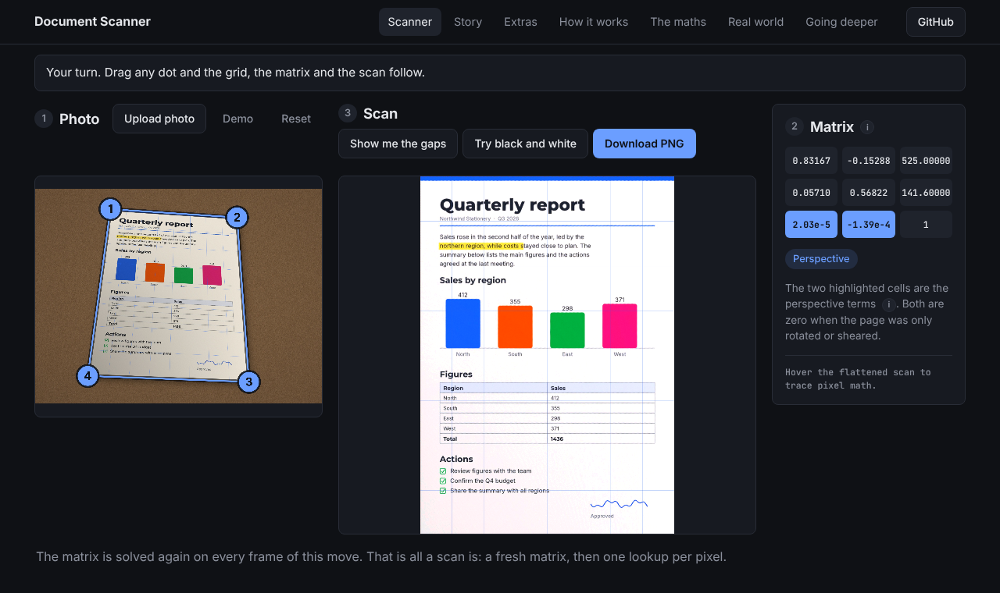

# Document Scanner


Ever take a photo of a document at an angle and it looks squashed and skewed? This project fixes exactly that and shows you the maths while it does the magic. Drag the four dots onto the corners of the page and watch a flat scan appear.

Developed by **Team BMTL** for the **CIS GV Hackathon 2026**.

## Features
- **Perspective Correction:** Drag the four corners onto your page and it gets flattened out.
- **Grayscale:** Convert the image into shades of grey.
- **Black and White:** Convert the image into black and white with stronger contrast.
- **Enhance:** Improve the image's colours and overall appearance.
- **Plain Crop:** Perspective correction compared to a simple crop.
- **Forward Mapping:** Shows the difference between forward and backward mapping.
- **Magnifier:** Zoom in on the document's corners.
- **Pixel Tracing:** Hhover over the scan to see where a pixel came from in the photo.
- **Matrix view:** Sshows the numbers behind the transform, updating as you move the dots.


## How It Works
When you take a picture of a page from an angle, it no longer looks like a rectangle. Instead, it looks like a distorted shape. A perspective transform fixes this by turning the shape back into a rectangle. The mathematical process behind this is called a **homography**.

1. You place four dots on the corners of the page.
2. Each corner gives two equations (one for x, one for y), so four corners give eight equations for eight unknown numbers.
3. We solve those with Gaussian elimination, which gives us the homography matrix. The ninth number is fixed at 1, because the matrix only matters up to scale.
4. For every pixel (u, v) in the flat scan, the matrix tells us where to look (x, y) in the original photo:
```
x = (h0·u + h1·v + h2) / (h6·u + h7·v + 1)
y = (h3·u + h4·v + h5) / (h6·u + h7·v + 1)
```
 
   We go backwards like this on purpose. Pushing photo pixels forward onto the page leaves holes, while asking each scan pixel where to look fills every one.
5. The spot we land on usually falls between pixels, so we blend the four nearest ones (bilinear interpolation) to get a smooth colour.
6. Greyscale, black and white and Enhance are applied last, pixel by pixel, and don't change the shape of the page.
 
The two highlighted cells in the matrix (h6 and h7) are the perspective terms. They drop to zero when the page was only rotated or sheared.

## Built with
 
Plain HTML, CSS and JavaScript. No libraries, no frameworks, no API, no sign-in, no machine learning.
 
```
index.html            the whole page: scanner, story, maths and the rest
 
css/
  base.css            fonts, colour variables, reset and text styles
  layout.css          where things sit, plus the responsive rules
  components.css      buttons, panels, matrix, controls and accordion
 
js/
  The maths
    engine.js         builds the 8 equations and solves them (Gaussian elimination)
    geometry.js       checks the dots make a proper page and gives back a ready matrix
    warp.js           per-pixel loops: backward scan, forward demo, greyscale, black and white
 
  Working with the photo
    photo.js          loads photos (upload, drop, paste, URL), fixes rotation, scales down
    exporter.js       renders the full-size scan and saves it as a PNG
 
  Interaction
    dots.js           the four draggable dots, with mouse, touch and keyboard control
    loupe.js          the magnifier that follows a dot
    demo.js           the opening animation where the dots glide onto the corners
 
  Showing the working
    phase4.js         the grid, the matrix display and the pixel tracer
    notes.js          the explanation text shown under the scanner
    tips.js           the small "i" pop-ups that define terms
 
  Gluing it together
    config.js         every tunable number in one place
    main.js           app state, redraw scheduling, and every button, slider and switch
    page.js           highlights the current section in the nav
 
assets/
  sample.jpg            the demo photo
  favicon.svg           the tab icon
  preview-*.png         the screenshots used in this README
  fonts/                Inter and JetBrains Mono, with their licences
```

## Privacy

Images are processed directly in the browser. Uploaded photographs are not sent to an external server.

<sub>We used AI to help with our code and to talk through and flesh out our logic.</sub>
